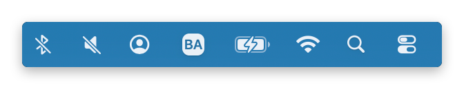
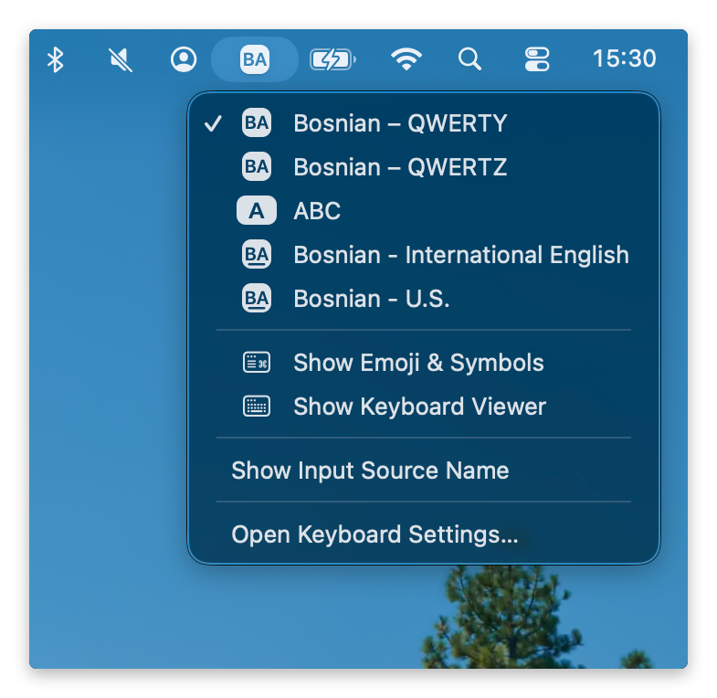
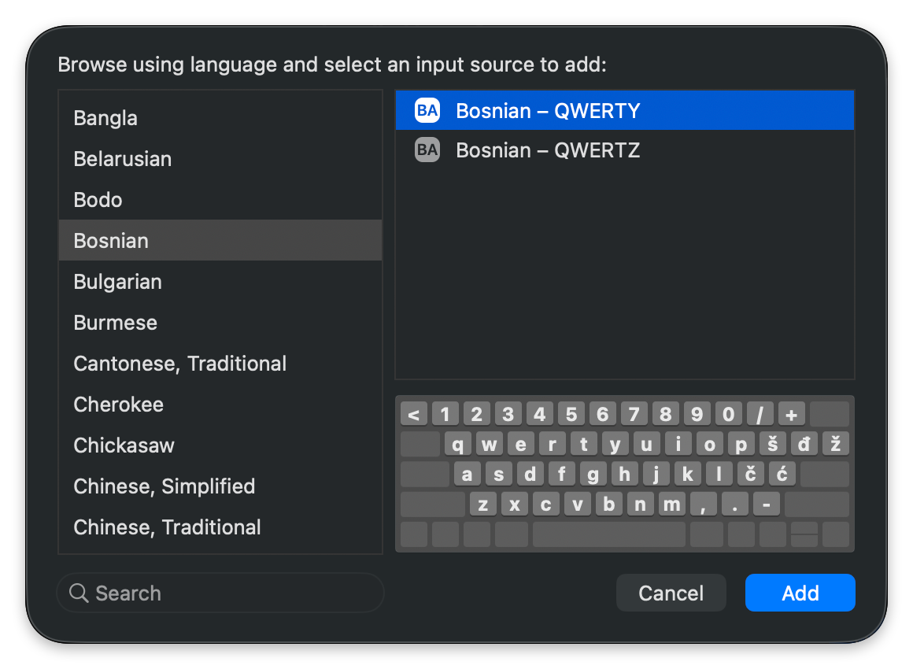
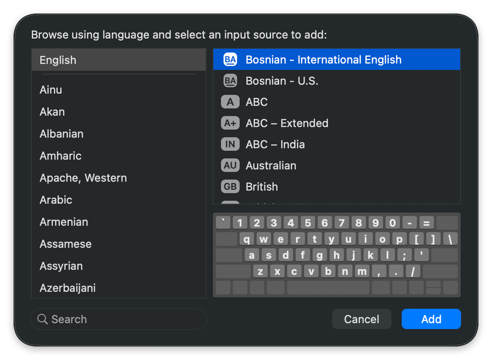

# Bosnian macOS Keyboard

macOS does not ship Bosnian keyboard layouts. This package adds them, with a **BA** badge in the menu
bar drawn to match the badges macOS draws for its own layouts.



## Layouts

| Layout | For |
| --- | --- |
| **Bosnian – QWERTY** | The Bosnian layout, Y and Z in the QWERTY positions |
| **Bosnian – QWERTZ** | The Bosnian layout, Y and Z swapped as on a local keyboard |
| **Bosnian - International English** | English typing, listed under Bosnian |
| **Bosnian - U.S.** | English typing, listed under Bosnian |

The two English layouts carry a line under the letters on the badge, so you can tell them apart in
the menu.



## Install

1. **[Download the latest release](https://github.com/eldarc/bosnian-macos-keyboard/releases/latest/download/bosnian-macos-keyboard.zip)**
   and unzip it.
2. Open the folder `/Library/Keyboard Layouts`. In Finder, press **⇧⌘G**, type that path and press
   Return. Or paste this into Terminal:

   ```bash
   open /Library/Keyboard\ Layouts
   ```

3. Copy **Bosnian.bundle** into that folder. macOS asks for your password, because this folder belongs
   to the whole Mac rather than to one account. From the folder you unzipped, this does the same:

   ```bash
   sudo cp -R Bosnian.bundle /Library/Keyboard\ Layouts/
   ```

4. **Restart your Mac.** macOS reads the installed keyboard layouts once at the start of a session and
   caches them, so the new layouts stay hidden until it reads them again. A restart is the one thing
   that reliably refreshes every part of the system.
5. Open **System Settings → Keyboard → Input Sources → Edit…**, click **+**, choose **Bosnian**, pick
   the layouts you want and click **Add**.



The two English layouts are listed under **English**, not Bosnian:



### Why `/Library` and not your own `~/Library`

The login and lock screens run outside your account, so they can only use layouts that are installed
for the whole Mac. `/Library/Keyboard Layouts` is read by the system itself and serves every account,
which is what makes the layouts available on the lock screen. A copy in your home folder is only ever
read once you are logged in.

### At the login screen

Right after your Mac starts up, before anyone has logged in, the login screen still offers only the
layouts macOS ships with. The Bosnian layouts are not there yet, so sign in with the layout you used
before.

Once you have logged in, they are loaded for the rest of that session. Lock your screen and the
Bosnian layouts are available there, so this only affects the very first sign-in after a boot.

## Uninstall

Remove `Bosnian.bundle` from `/Library/Keyboard Layouts` — macOS asks for your password — then restart.
Removing the layouts in System Settings first keeps the input menu tidy.

## Notes

- If you replace the bundle with a newer version and nothing changes, restart: macOS caches keyboard
  layouts and their icons for the whole session.
- If a restart is not enough and an old icon is still showing, delete that cache and restart again:

  ```bash
  rm -f "$(getconf DARWIN_USER_CACHE_DIR)"/com.apple.IntlDataCache.le*
  ```
- Tested on macOS 27. The lettered badges replaced the flag icons in macOS 12.4, so the icon suits
  macOS 12.4 and later.

## About the badge

macOS draws the badges for its own layouts from a list built into the system, and there is no way for
a third-party layout to add to it. The icon here is therefore drawn to match: the same height, corner
radius, font, weight and letter size as the badges macOS draws for itself, measured from the system's
own rendering. A layout bundle's icon is shown in a 16 pt square rather than the 22 pt the system
uses, so the badge is narrower; everything else lines up.

## Building

[`tools/make-badges.swift`](tools/make-badges.swift) draws the icons in [`icons/`](icons). The design
decisions are documented at the top of the file.

```bash
swift tools/make-badges.swift
```

[`tools/build-release.py`](tools/build-release.py) packs `bundle/` into the archive attached to a
release. It skips Finder leavings, stores the file names as UTF-8 so the two layouts with an en dash
in their name survive being unzipped, and reads the archive back to check that every file unpacks
exactly as it went in.

```bash
python3 tools/build-release.py
```

It writes `dist/bosnian-macos-keyboard.zip`. Upload it under that name, which is the one the download
link above asks for.

## License

[MIT](LICENSE).
